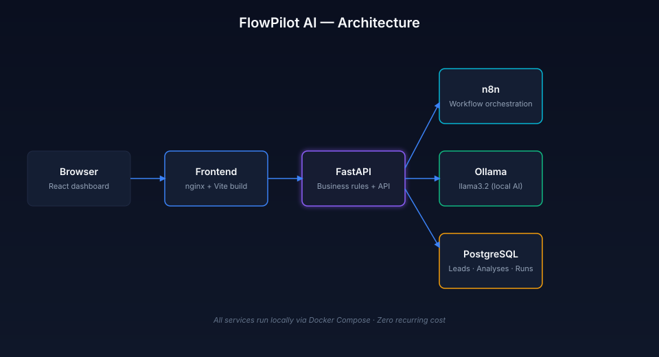

# FlowPilot AI

**AI-powered business automation platform.** n8n orchestrates a lead intake workflow, a local AI model analyzes each inquiry, deterministic business rules classify it, and a polished React dashboard makes every step visible.

Built as a **production-style reference** for combining workflow orchestration, AI, APIs, databases, and full-stack development — in one working system that runs at $0 operating cost.

---

## The problem

Small businesses receive leads from multiple channels. Manually reviewing every inquiry — deciding which ones matter, saving them somewhere, and notifying the right person — wastes hours per week and often lets good opportunities slip.

## The solution

FlowPilot AI automates the entire intake path:

1. A lead arrives via webhook, form, or API.
2. Input is validated and stored.
3. A local AI model (running on the same machine, no per-request API fees) extracts structured information: summary, category, budget, urgency.
4. The AI output is **schema-validated in code** — malformed responses never reach the database.
5. Deterministic business rules decide priority and status. The AI interprets; the rules decide.
6. Results are stored in PostgreSQL and surfaced in a React dashboard.
7. Failures are visible, diagnosable, and safely retryable.

The workflow is the demonstration. The pattern — **webhook → validate → AI → rules → persist → display** — applies to any business process.

---

## Architecture



```
Browser (React dashboard)
        ↓  HTTPS
nginx (static + reverse proxy)
        ↓  /api/*
FastAPI backend ──────► PostgreSQL
        ↑                    ↑
        │                    │
        │                    │
        └──── n8n ───────────┘
                ↓
              Ollama
         (local AI inference)
```

| Layer | Role |
|---|---|
| **React + TypeScript + Vite** | Dashboard, lead management, execution history |
| **nginx** | Serves static build, proxies `/api` to FastAPI |
| **FastAPI** | Validation, business rules, REST API |
| **n8n** | Workflow orchestration, webhook intake |
| **Ollama** | Local AI inference (`llama3.2`) — no cloud API costs |
| **PostgreSQL** | Persistent storage for leads, analyses, executions |
| **Docker Compose** | One-command local stack |

---

## Features

### End-to-end workflow
- Webhook intake with strict input validation
- Local AI analysis via Ollama with schema-enforced JSON output
- Deterministic qualification engine (priority + status + reasons)
- Structured persistence with audit trail

### Dashboard
- **Overview** — total/qualified/high-priority leads, success rate, lead sources donut, activity feed, hot leads panel
- **Leads** — searchable, filterable table with tab pills and detail drawer showing AI analysis and manual status updates
- **Workflow Runs** — execution history with tabs (success / failed / running), duration, stage, and error details

### Reliability
- Retries on all external calls (n8n → FastAPI → Ollama)
- AI output validated in code — empty summaries, unknown categories, or invalid budgets route to a visible `needs_review` state instead of a false success
- Stale execution cleanup — orphaned runs are automatically marked failed
- Visible failure paths in both the workflow and the dashboard

### Quality
- 30+ backend tests (pytest + httpx)
- Structured database migrations via Alembic
- Clean separation: n8n orchestrates, FastAPI owns rules, Ollama interprets
- Fully containerized — one command to run everything

---

## Tech stack

| Layer | Technology |
|---|---|
| Frontend | React 18, TypeScript, Vite, Tailwind CSS, TanStack Query, Recharts |
| Backend | Python 3.11, FastAPI, SQLAlchemy, Pydantic, Alembic |
| Workflow | n8n Community Edition |
| AI | Ollama running `llama3.2` locally |
| Database | PostgreSQL 16 |
| Runtime | Docker Compose |
| Testing | pytest, httpx |

---

## Local setup

### Prerequisites

- Docker Desktop (macOS or Linux)
- [Ollama](https://ollama.com/download) installed on the host
- `llama3.2` model pulled: `ollama pull llama3.2`

### 1. Clone

```bash
git clone https://github.com/Vitalikkam/flowpilot-ai.git
cd flowpilot-ai
```

### 2. Configure environment

```bash
cp .env.example .env
# Edit .env and set a strong POSTGRES_PASSWORD
```

### 3. Start Ollama with network access

**macOS:**
```bash
OLLAMA_HOST=0.0.0.0:11434 ollama serve
```

**Linux:**
```bash
sudo systemctl edit ollama
# Add:
# [Service]
# Environment="OLLAMA_HOST=0.0.0.0:11434"
sudo systemctl daemon-reload
sudo systemctl restart ollama
```

### 4. Start the stack

```bash
docker compose up -d --build
```

Services start:

- **Dashboard:** http://localhost:5173
- **FastAPI docs:** http://127.0.0.1:8000/docs
- **n8n editor:** http://localhost:5678

### 5. Import the n8n workflow (first time only)

1. Open n8n at http://localhost:5678
2. Create the owner account
3. Import `n8n/workflows/lead-intake.json`
4. Activate the workflow

### 6. Seed demo data (optional)

```bash
docker compose exec api python seed.py
```

Populates the database with 15 realistic leads, AI analyses, and workflow executions — perfect for exploring the dashboard.

---

## Project structure

```
flowpilot-ai/
├── backend/
│   ├── app/
│   │   ├── api/              REST endpoints
│   │   ├── core/             DB session, config
│   │   ├── models/           SQLAlchemy models
│   │   ├── schemas/          Pydantic schemas
│   │   └── services/         Business logic
│   ├── alembic/              Migrations
│   ├── tests/                pytest suite
│   └── seed.py               Demo data
├── frontend/
│   ├── src/
│   │   ├── components/       UI components
│   │   ├── pages/            Route pages
│   │   ├── hooks/            React Query hooks
│   │   ├── services/         Typed API client
│   │   └── types/            TypeScript types
│   ├── Dockerfile
│   └── nginx.conf
├── n8n/
│   └── workflows/            Exported workflow JSON
├── docs/
│   └── architecture.svg
├── docker-compose.yml
└── README.md
```

---

## Screenshots

### Overview dashboard


### Leads page with detail drawer


### Workflow runs with execution details


### n8n workflow


> Screenshots coming soon. See `docs/screenshots/` for the folder.

---

## How it works — one lead's journey

A lead submits:

> "We need a custom web application with an $8,000 budget. Would like to start this month."

1. **Webhook** receives the POST payload
2. **Validate Input** checks required fields and format
3. **Create Lead** stores it in PostgreSQL with `status: pending`
4. **Log Start** records the execution in `workflow_executions`
5. **Analyze Lead** calls Ollama with a strict JSON schema
6. **Parse + Validate AI** rejects malformed output
7. **Evaluate Lead** calls FastAPI, which applies the rules engine
8. **Update Success** closes the execution log
9. **Respond OK** returns the lead, analysis, and qualification to the caller

Result: `priority: high`, `status: qualified`, with reasons (`High urgency`, `Budget ≥ $5000`, `High-fit category`).

If any step fails, the lead lands in `needs_review` with a diagnosable reason — never a silent failure.

---

## Limitations & next steps

This is a **local-first** project. It is not yet a hosted SaaS. Known limitations:

- **Public hosting** is not included. Everything runs on localhost.
- **Authentication** is not implemented. The dashboard assumes a trusted user.
- **Email notifications** are stubbed. A production system would send alerts.
- **Idempotency keys** are partially implemented for lead intake.
- **Multi-tenant** is not supported.

These are deliberate scoping choices — the goal is a credible working system, not a full SaaS product.

---

## About

Built by [Vitalii Kamulia](https://github.com/Vitalikkam) as a demonstration of AI-powered workflow automation, API integration, and full-stack engineering.

If you're looking for help automating a business process, integrating an AI model, or building a custom dashboard — feel free to get in touch.